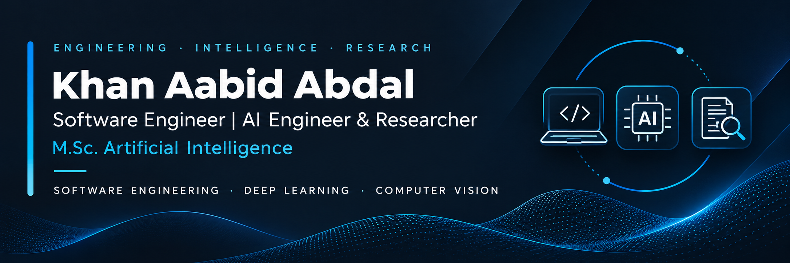

# Khan Aabid Abdal

## About Me

**Software Engineer | AI Engineer & Researcher | M.Sc. Artificial Intelligence**

I'm a Full Stack Developer at Al Shahin Metal Industries, Saudi Arabia, working on enterprise applications, ERP systems, and web development using PHP, Laravel, JavaScript, and MySQL.

I hold a Master's degree in Artificial Intelligence and a Bachelor's degree in Physics. My technical interests span software engineering, backend development, machine learning, deep learning, and computer vision.

My AI experience includes developing machine learning applications, fine-tuning deep learning models, and deploying interactive AI solutions.

I have also published research on detecting AI-generated images using fine-tuned ResNet50 models.

**Published Research:** [Classifying Real and AI-Generated Images Using Fine-Tuned ResNet50](https://doi.org/10.56147/aaiet.1.2.7)

Beyond my professional work, I build independent projects, explore modern web technologies, and share technical knowledge through open-source repositories and engineering articles.

**My focus:** Building reliable software systems and developing practical AI-powered applications.

## Connect With Me

- **Location:** Riyadh, Saudi Arabia
- **Email:** [khanaabidabdal@gmail.com](mailto:khanaabidabdal@gmail.com)
- **LinkedIn:** [Professional Profile](https://www.linkedin.com/in/aabid-abdal-khan/)
- **Medium:** [Technical Articles](https://medium.com/@khanaabidabdal)
- **Google Scholar:** [Research Profile](https://scholar.google.com/citations?user=T5mH21oAAAAJ&hl=en)
- **Hugging Face:** [AI Applications & Models](https://huggingface.co/khanaabidabdal)
- **Kaggle:** [Data Science Profile](https://www.kaggle.com/khanaabidabdal)
- **X (Twitter):** [@KhanAbdalAabid](https://x.com/KhanAbdalAabid)

## Technical Skills & Technologies

- **Programming Languages:** PHP, JavaScript, TypeScript, Python, R, SQL
- **Backend Development:** PHP, Laravel, REST APIs, Server-Side Development
- **Frontend Development:** HTML5, CSS3, JavaScript, React.js, Next.js, Tailwind CSS
- **CMS & Web Platforms:** WordPress
- **Databases:** MySQL, SQL, Relational Database Design
- **AI & Machine Learning:** Scikit-learn, TensorFlow, PyTorch, Deep Learning, Computer Vision, Transfer Learning
- **Data Science & Visualization:** Pandas, NumPy, Matplotlib, Seaborn, Plotly, Power BI
- **AI Application Development:** Gradio, Hugging Face Spaces, Model Fine-Tuning and Deployment
- **Development Tools & Technologies:** Git, GitHub, VS Code, Node.js, Apache, Laragon, Google Colab

## Certifications

### Artificial Intelligence & Machine Learning

- [Machine Learning with Python: Zero to GBMs](https://jovian.com/certificate/MFQTQOBZHA) — Jovian
- [PyTorch for Deep Learning: Zero to Mastery](https://www.udemy.com/certificate/UC-c0db8e71-d937-4bfc-91cc-c54142e3a863/) — Udemy
- [Deep Learning with TensorFlow 2](https://learn.365datascience.com/certificates/CC-1104F3BC8B/) — 365 Data Science
- Artificial Intelligence Foundations: Neural Networks — LinkedIn Learning

### Data Science & Databases

- [Data Analysis with Python: Zero to Pandas](https://jovian.com/certificate/MFQTQMRXHA) — Jovian
- [Data Scientist Career Track](https://learn.365datascience.com/certificates/DD-E0079E4F95/) — 365 Data Science
- [SQL Basic](https://learnsql.com/files/course-certificate/hPcOEEqjgMuFqmKLxDLpJdojwWHoUveCpbszBLmo) — LearnSQL.com
- Python for Data Science Essential Training — LinkedIn Learning

## Professional Experience

### Full Stack Developer | Al Shahin Metal Industries
**Saudi Arabia | June 2025 – Present**

- Develop and maintain enterprise web applications and ERP systems using PHP, Laravel, JavaScript, and MySQL.
- Work across frontend and backend development, implementing application features and business workflows.
- Develop and integrate REST APIs to support application functionality and data exchange.
- Work with relational databases, SQL queries, and server-side application logic.
- Contribute to the development and maintenance of the company's website and internal software systems.

### NLP Intern | TCS iON — Rio 125 Internship
**September 2023 – December 2024**

- Developed a natural language processing application for detecting and correcting grammatical errors.
- Applied the T5-base transformer model to text correction tasks.
- Gained practical experience with NLP workflows and transformer-based language models.

### Data Analyst Intern | MeriSKILL
**September 2023 – October 2023**

- Developed a sales dashboard using Microsoft Excel to visualize business performance.
- Built a machine learning model for diabetes prediction, applying data preprocessing and predictive modeling techniques.

## Education

### Master of Science (M.Sc.) in Artificial Intelligence
**B.K. Birla College (Autonomous)** | August 2022 – July 2024

- **CGPA:** 8.63

### Bachelor of Science (B.Sc.) in Physics
**B.K. Birla College (Autonomous)** | June 2019 – April 2022

- **CGPA:** 9.8

## Featured Projects

### Software Engineering

**[The Salafi Store](https://thesalafistore.com)**

An e-commerce platform currently under development, focused on Islamic books and essentials. The project involves full-stack application development, product catalogue management, multilingual support, database design, API development, and responsive storefront design.

**Technologies:** Next.js, React, TypeScript, Tailwind CSS, PostgreSQL, Vercel

**Status:** In Development | Private Repository

**[Full-Stack Web Development Roadmap](https://github.com/khanaabidabdal/web-development-roadmap)**

A structured, open-source, 16-week, project-based learning resource covering frontend development, backend engineering, databases, APIs, testing, and deployment. Designed to strengthen software engineering fundamentals and provide a freely accessible learning resource for developers.

**Technologies:** HTML, CSS, JavaScript, TypeScript, Git

**Status:** Ongoing

### AI & Machine Learning

**[Reality Check — Real vs. AI-Generated Image Classifier](https://github.com/khanaabidabdal/Ai-Image-Classifier-Real-Vs-Fake-Faces)**

Developed a ResNet50-based computer vision application for classifying real and AI-generated face images. Implemented an interactive Gradio interface and deployed the application on Hugging Face. Documented subsequent model retraining using additional images, separate from the published research experiments.

**Technologies:** Python, PyTorch, ResNet50, Gradio, Hugging Face

[Live Application](https://huggingface.co/spaces/khanaabidabdal/RealityCheck)

**[Automated Grammatical Error Detection and Correction](https://github.com/khanaabidabdal/Automate-Detection-And-Correction-of-Grammatical-Errors)**

Developed an NLP application using the T5 transformer model to detect and correct grammatical errors in English text as part of the TCS iON internship.

**Technologies:** Python, NLP, Transformers, T5

**[Fruitify — Fruit Image Classification](https://github.com/khanaabidabdal/Fruitify)**

Developed a deep learning application using transfer learning with ResNet50 to classify images across 100 fruit categories.

**Technologies:** Python, PyTorch, ResNet50, Transfer Learning

[Live Application](https://huggingface.co/spaces/khanaabidabdal/fruitify)

### Databases & Analytics

**[Comprehensive Analysis of Bike Store Database](https://github.com/khanaabidabdal/Comprehensive-Analysis-of-Bike-Store-Database)**

Explored a relational retail database to analyze customers, orders, products, and sales performance using SQL.

**Technologies:** SQL, Relational Databases

## Published Research

**[Classifying Real and AI-Generated Images Using Fine-Tuned ResNet50](https://doi.org/10.56147/aaiet.1.2.7)**

Published in the *Journal of Advanced Artificial Intelligence, Engineering and Technology* (2025).

Research focused on applying transfer learning and fine-tuning with ResNet50 to distinguish real and AI-generated images.

**Research Areas:** Artificial Intelligence, Computer Vision, Deep Learning, Transfer Learning, AI-Generated Image Detection

**DOI:** 10.56147/aaiet.1.2.7

[Read Publication](https://doi.org/10.56147/aaiet.1.2.7) | [Explore Related Application](https://github.com/khanaabidabdal/Ai-Image-Classifier-Real-Vs-Fake-Faces) | [Google Scholar](https://scholar.google.com/citations?user=T5mH21oAAAAJ&hl=en)

## Honors and Awards

### Second Prize — Fizi-Talks

**Somaiya College, Vidyavihar, Mumbai**

Awarded second prize for a presentation on the life and scientific contributions of Dr. Vikram Sarabhai, highlighting his pioneering role in the development of India's space programme.

## Let's Connect

I'm interested in software engineering, AI-powered applications, computer vision research, open-source collaboration, and continuous technical learning.

I'm open to connecting with developers, researchers, and technology professionals to exchange ideas and explore meaningful opportunities.

[Connect on LinkedIn](https://www.linkedin.com/in/aabid-abdal-khan/) | [Read My Articles](https://medium.com/@khanaabidabdal) | [Explore My Research](https://scholar.google.com/citations?user=T5mH21oAAAAJ&hl=en)
